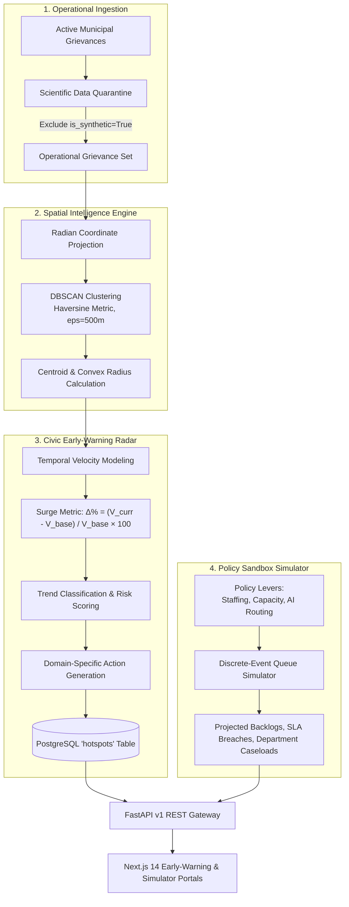

# CivicMind AI — Phase 6: Geospatial Grievance Intelligence & Early-Warning Radar Architecture

## 1. System Overview

Phase 6 implements the **Geospatial Grievance Intelligence, Civic Early-Warning Radar, and Counterfactual Workload Simulator** for CivicMind AI.

The engine transitions municipal grievance administration from reactive complaint resolution to **proactive spatial anomaly detection and predictive capacity planning**.

---

## 2. Mathematical Formulations

### 2.1 Spherical Haversine Metric
For any two geographical coordinates on Earth $(\phi_1, \lambda_1)$ and $(\phi_2, \lambda_2)$ in radians:
$$d = 2 R \arcsin \left( \sqrt{\sin^2\left(\frac{\Delta\phi}{2}\right) + \cos(\phi_1)\cos(\phi_2)\sin^2\left(\frac{\Delta\lambda}{2}\right)} \right)$$
where $R = 6371.0088 \text{ km}$ ($6,371,008.8 \text{ meters}$).

The DBSCAN epsilon neighborhood parameter for a target radius of $r = 500\text{ m}$ ($0.5\text{ km}$) is defined as:
$$\epsilon_{\text{radians}} = \frac{0.5}{6371.0088} \approx 7.84805 \times 10^{-5} \text{ rad}$$

### 2.2 Incident Velocity & Surge Metric ($\Delta\%$)
Incident velocity is measured across temporal slices $V = [v_1, v_2, \dots, v_n]$ where $v_n$ is the current time slice and baseline velocity is the historical mean:
$$V_{\text{baseline}} = \frac{1}{n-1} \sum_{i=1}^{n-1} v_i$$
$$\Delta\% = \left( \frac{V_{\text{current}} - V_{\text{baseline}}}{\max(1, V_{\text{baseline}})} \right) \times 100$$

- **Increasing Trend**: $\Delta\% \ge +20.0\%$
- **Decreasing Trend**: $\Delta\% \le -20.0\%$
- **Stable Trend**: $-20.0\% < \Delta\% < +20.0\%$

### 2.3 Composite Risk Scoring (0–100)
$$S_{\text{risk}} = \min\left(100, \max\left(15, S_{\text{base}} + W_{\text{vol}} \cdot C + W_{\text{trend}} + \min\left(15, \left\lfloor \frac{\Delta\%}{15} \right\rfloor\right)\right)\right)$$
- $S_{\text{risk}} \ge 75 \implies \text{Critical}$
- $50 \le S_{\text{risk}} < 75 \implies \text{High}$
- $30 \le S_{\text{risk}} < 50 \implies \text{Medium}$
- $S_{\text{risk}} < 30 \implies \text{Low}$

---

## 3. Strict Scientific Separation & Benchmark Quarantine

To maintain absolute scientific and operational integrity, **synthetic benchmark records (`BENCHMARK_RESEARCH_DATASET_v1`) are quarantined from operational clustering**:

1. Any record where `is_synthetic = True`, `id.startswith("SYN-")`, or `source = "synthetic_benchmark"` is strictly filtered out prior to spatial clustering.
2. Production hotspots persisted to PostgreSQL are tagged with `source="operational"`.
3. Invariant test `test_synthetic_data_segregation_invariant` asserts that synthetic records are never clustered into operational municipal hotspots.

---

## 4. Counterfactual Workload Simulator

The simulator models the macro-equilibrium of municipal casework queues under various administrative policy levers:

- **Officer Headcount**: Each officer injection reduces active caseload by 22 cases/period.
- **Department Capacity Multiplier**: Throughput scaling reduces bottleneck backlogs by up to 280 cases/multiplier unit.
- **Inter-Departmental Load Redistribution**: Cross-functional assistance flattens peak loads by up to 140 cases.
- **AI Routing Accuracy Factor**: Eliminates bounce-back misrouting latency.
- **Escalation Threshold**: Accelerated supervisor alerts reduce SLA breach probabilities by 25%.

The simulator projects before-and-after department loads for:
1. Water Supply & Sewerage
2. Solid Waste Management
3. Electricity & Lighting
4. Public Works (Roads)
5. Public Health
6. Horticulture & Parks

---

## 5. API Endpoints

| Method | Endpoint | Description |
|---|---|---|
| `GET` | `/api/v1/early-warning/hotspots` | Query active spatial clusters filtered by category, risk level, or ward |
| `GET` | `/api/v1/early-warning/hotspots/{id}` | Inspect hotspot dossier and associated complaint IDs |
| `POST` | `/api/v1/early-warning/hotspots/{id}/acknowledge` | Dispatch emergency response task force and record audit trail |
| `GET` | `/api/v1/early-warning/summary` | Aggregate civic radar metrics (total, critical, surges, distributions) |
| `POST` | `/api/v1/early-warning/scan` | Administratively trigger spatial clustering scan across active complaints |
| `POST` | `/api/v1/simulator/run` | Execute counterfactual what-if workload simulation |
| `GET` | `/api/v1/simulator/baseline` | Retrieve unperturbed baseline municipal workload numbers |
